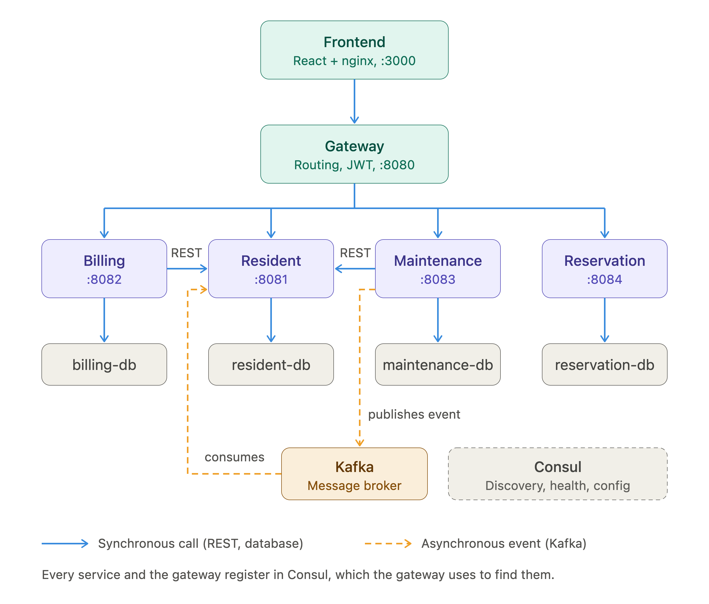

# Property Management System

A microservices-based system for a housing cooperative. Residents report maintenance issues,
see and pay invoices and book shared resources. Board members manage the building, assign
work and generate invoices, and maintenance workers handle their assigned work orders. Built
for the PG3402 Microservices exam.

The system has four business services (resident, billing, maintenance and reservation), a
gateway that is the single entry point, and a React frontend. Each service has its own
Postgres database. The services talk to each other synchronously over REST and
asynchronously through Kafka, and register in Consul for service discovery. Everything runs
with `docker compose up`.

## Contents

- [Ways to run the project](#ways-to-run-the-project)
- [Quick start (Docker Compose)](#quick-start-docker-compose)
- [Running the services in the IDE](#running-the-services-in-the-ide)
- [Demo users and data](#demo-users-and-data)
- [User stories to try](#user-stories-to-try)
- [Architecture](#architecture)
- [Consul, load balancing and Kafka](#consul-load-balancing-and-kafka)
- [Running the tests](#running-the-tests)
- [Team and contributions](#team-and-contributions)
- [Troubleshooting](#troubleshooting)
- [More documentation](#more-documentation)

## Ways to run the project

| Way | Use it for | Where |
|---|---|---|
| Docker Compose (recommended) | Running the whole system | [Quick start](#quick-start-docker-compose) |

## Quick start (Docker Compose)

**You need:** Docker with Compose. Nothing else has to be installed.

1. Unzip the project and open a terminal in the project folder.
2. Create the settings file:

```bash
cp .env.example .env
```

3. Start everything (the first build takes a few minutes):

```bash
docker compose up --build
```

4. Wait until all containers are `healthy`. You can check with `docker compose ps`.
5. Open **http://localhost:3000** and sign in with one of the [demo users](#demo-users-and-data).

The default values in `.env.example` work as they are, so nothing has to be edited to try the
project. With the defaults, the board and the workers use the password `change-this-password`.
Change the values in `.env` for anything other than a demo. `JWT_SECRET` must be at least 32
characters and is shared by all services.

| Address | What |
|---|---|
| http://localhost:3000 | The application |
| http://localhost:8500 | Consul UI (services and their health, configuration) |

Only the frontend (nginx) is published for the application. It serves the React app and
proxies `/api` to the gateway. The gateway and the services are reachable inside the Docker
network only, so no request can skip the JWT check. The databases (5432-5435) and Consul
(8500) are also published for inspection.

To start from scratch with empty databases and fresh demo data: `docker compose down -v`. Set `FRONTEND_PORT` in `.env` if port 3000 is busy.


## Demo users and data

On first start every service fills its empty database with demo data: two buildings
("Solsiden Borettslag" with 6 apartments and "Havneparken" with 2 vacant ones), 8 residents,
invoices for last and this month (one overdue), 7 maintenance requests in all statuses, 3
workers, 5 resources (3 parking spaces, a common room and a roof terrace), some upcoming
bookings, and photos of apartments and a facade. Set `SEED_DEMO_DATA=false` to start with only
the board account and the workers.

| Role | Sign in at | Email | Password |
|---|---|---|---|
| Board member | http://localhost:3000 | `board@example.com` | `BOARD_SEED_PASSWORD` (`change-this-password` by default) |
| Resident | http://localhost:3000 | `kari@example.com` (also `ola@`, `ingrid@`, `lars@`, `sofie@`, `emil@`, `nora@example.com`) | `demo-resident-pw` |
| Maintenance worker | http://localhost:3000/worker/login | `per@example.com` (plumbing, heating), `jon@example.com` (electrical, appliances), `ola@example.com` (all) | `WORKER_SEED_PASSWORD` (`change-this-password` by default) |

Seeding only happens when a database is empty, so it does not run again on an existing
volume. Use `docker compose down -v` to reset.

## User stories to try

The complete list with priorities is in [docs/requirements.md](docs/requirements.md). These
scenarios cover the main functionality.

| Story | Sign in as | How to try it |
|---|---|---|
| Resident sees apartment, household and contact details | `kari@example.com` | Home, then Account |
| Resident reports a maintenance issue and follows its status | `kari@example.com` | Maintenance, then report a new issue |
| Board assigns a request to a worker | `board@example.com` | Maintenance, then pick a worker |
| Worker accepts, starts and completes a request | `per@example.com` at `/worker/login` | Work orders |
| Resident gets a notification when the request is completed (asynchronous event) | `kari@example.com` | Notifications, after the worker completes a request |
| Resident and worker comment on a request | `kari@example.com` and `per@example.com` | Open a request and add a comment |
| Board manages residents and apartments, and apartment photos | `board@example.com` | Residents and Apartments |
| Board generates monthly invoices and marks them paid | `board@example.com` | Invoices |
| Resident sees invoices and simulates payment | `kari@example.com` | Invoices |
| Resident books and cancels a shared resource | `kari@example.com` | Reservations |
| Board blocks a resource for a period | `board@example.com` | Resources |

**Suggested end-to-end demo:** as `kari@example.com` report a maintenance issue. As
`board@example.com` assign it to Per. As `per@example.com` at `/worker/login`, accept, start and
complete it. Sign in as Kari again and open Notifications.

## Architecture



Solid blue arrows are synchronous calls (REST and database access). Dashed yellow arrows are
asynchronous events sent through Kafka. Every service and the gateway register in Consul.

| Service | Port | Responsibility | Database |
|---|---|---|---|
| frontend | 3000 | React app served by nginx, proxies `/api` | |
| gateway | 8080 | Routing, CORS, JWT check, login rate limit, load balancing | |
| resident-service | 8081 | Apartments, residents, login, notifications | `resident-db` (5432) |
| billing-service | 8082 | Monthly invoices, payments, invoice PDF | `billing-db` (5433) |
| maintenance-service | 8083 | Maintenance requests, workers, work orders, comments | `maintenance-db` (5434) |
| reservation-service | 8084 | Shared resources and bookings | `reservation-db` (5435) |
| security-common | | Shared JWT library, not a deployable service | |
| consul | 8500 | Service discovery, health, central configuration | |
| kafka | 9092 | Message broker (KRaft, single node) | |

Each service owns its database (schema managed by Flyway) and never reads another service's.

**Communication**

| Kind | From | To | Why |
|---|---|---|---|
| Synchronous (REST) | gateway | the four services | Routing by path |
| Synchronous (REST) | billing-service | resident-service | Billing needs apartments and the signed-in resident to create and show invoices |
| Asynchronous (Kafka) | maintenance-service | resident-service | A completed request notifies the resident, and the services do not depend on each other |

**Gateway routes** (the `/api` prefix is stripped):

| Path | Service |
|---|---|
| `/api/auth`, `/api/residents`, `/api/apartments`, `/api/notifications` | resident-service |
| `/api/invoices` | billing-service |
| `/api/maintenance`, `/api/workers` | maintenance-service |
| `/api/reservations`, `/api/resources` | reservation-service |

The gateway validates the JWT, and each service validates it again and enforces its roles
(`RESIDENT`, `BOARD`, `WORKER`). Logins are limited to 5 per minute per client address
(`429` when exceeded, kept in memory per gateway instance).

More detail, including a sequence diagram of the event flow, is in
[docs/architecture.md](docs/architecture.md).

## Consul, load balancing and Kafka

**Consul** (http://localhost:8500) holds service discovery, health and shared configuration.
The gateway routes with `lb://<service-name>`, so it has no hard-coded service addresses.
The *Services* page shows each instance's health check (`/actuator/health`). The files in
[`consul-config/`](consul-config) are loaded into Consul's key/value store on every start and
read by the services at start-up. Secrets (`JWT_SECRET`, database passwords) stay in `.env`.
If Consul is unavailable, a service still starts with built-in defaults.

**Load balancing:** run two copies of the reservation service and the gateway spreads
requests over them.

```bash
docker compose up -d --scale reservation-service=2
```

Both instances appear in Consul. Use the Reservations page and watch
`docker compose logs -f reservation-service` alternate between `-1` and `-2`. Booking stays
safe with several instances, because the database refuses overlapping reservations for the
same resource. The login rate limit is kept per gateway instance, so run one gateway.

**Kafka:** when a worker completes a request, maintenance-service publishes
`MaintenanceCompleted` to the topic `maintenance.completed` after the database change is
saved. resident-service consumes it and stores a notification. To see the messages:

```bash
docker compose exec kafka /opt/kafka/bin/kafka-console-consumer.sh \
  --bootstrap-server localhost:9092 --topic maintenance.completed --from-beginning
```

## Running the tests

The backend tests that load a Spring context use real Postgres databases, so start them
first. Java 21 is required. Then run all modules from the repository root:

```bash
docker compose up -d resident-db billing-db maintenance-db reservation-db
./mvnw clean test
```

Frontend (Node 22):

```bash
cd frontend && npm ci && npm run lint && npm run build
```

GitHub Actions runs the same checks on every push and pull request, and `main` requires green
checks before a pull request can be merged.

## Troubleshooting

| Problem | Fix |
|---|---|
| `port is already allocated` (for example 5432) | Another container or Postgres uses the port. Stop it, or change the published port in `docker-compose.yml` |
| A service exits with `Could not resolve placeholder` | A value is missing in `.env`. Compare it with `.env.example` |
| Port 3000 is busy | Set `FRONTEND_PORT` in `.env` |
| Login keeps saying wrong email or password | Logins are limited to 5 per minute. Wait a minute |
| No demo data after start | The databases already had data. Run `docker compose down -v` and start again |
| Docker build fails with `parent snapshot ... does not exist` | Corrupt build cache: `docker builder prune -f` and build again |

## More documentation

- [Architecture and the MaintenanceCompleted event flow](docs/architecture.md)
- [Project overview and user stories](docs/requirements.md)