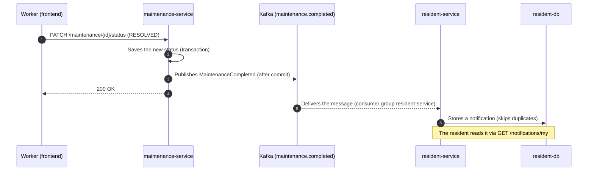

# Architecture

The system is split into four business services behind a single gateway. Each service owns
its data and is deployed as its own container. This document describes the services, how
they communicate, and how a request moves through the system.


Solid blue arrows are synchronous calls (REST and database access). Dashed yellow arrows are
asynchronous events sent through Kafka.

## Contents

- [Components](#components)
- [Communication](#communication)
- [Request flow and security](#request-flow-and-security)
- [Data ownership](#data-ownership)
- [Service discovery and configuration](#service-discovery-and-configuration)
- [When a service is slow or down](#when-a-service-is-slow-or-down)
- [Load balancing and several instances](#load-balancing-and-several-instances)
- [Event flow: MaintenanceCompleted](#event-flow-maintenancecompleted)
- [Known limitations](#known-limitations)

## Components

| Component | Port | Responsibility | Database |
|---|---|---|---|
| frontend | 3000 | React app served by nginx, proxies `/api` to the gateway | |
| gateway | 8080 | Single entry point: routing, CORS, JWT check, login rate limit, load balancing | |
| resident-service | 8081 | Residents, apartments, buildings and their photos, login, notifications (see the note below) | `resident-db` (5432) |
| billing-service | 8082 | Monthly invoices, payments, invoice PDF | `billing-db` (5433) |
| maintenance-service | 8083 | Maintenance requests, workers, work orders | `maintenance-db` (5434) |
| reservation-service | 8084 | Shared resources and bookings | `reservation-db` (5435) |
| security-common | | Shared library for JWT handling, not a deployable service | |
| consul | 8500 | Service discovery, health overview, central configuration | |
| kafka | 9092 | Message broker (KRaft, single node) | |

Only the frontend is published for the application. The gateway and the services are
reachable inside the Docker network only, so no request can skip the JWT check.

**Why resident-service also owns apartments and buildings.** Residents, apartments and buildings
share foreign keys and transactions: a resident lives in an apartment, an apartment belongs to a
building, and an apartment cannot be removed while people live in it. Most screens need them
together. Splitting them into two services would have turned every list into several network
calls and moved those rules out of the database, for no gain in scaling. The service name is
therefore narrower than its job (a name like `property-service` would fit better). The name was
kept because it is used in Docker, Consul, the gateway routes and the configuration, and changing
it late would have risked breaking those.

## Communication

| Kind | From | To | Why |
|---|---|---|---|
| Synchronous (REST) | browser | frontend, then gateway | Every user action goes through the gateway |
| Synchronous (REST) | gateway | the four services | Routing by path, using `lb://<service-name>` |
| Synchronous (REST) | billing-service | resident-service | Billing needs the apartments and the signed-in resident to generate and show invoices |
| Synchronous (REST) | maintenance-service | resident-service | When a resident reports an issue, maintenance looks up their apartment (forwarding the resident's own token) and stores it on the request, so workers see where to go |
| Synchronous (JDBC) | each service | its own database | Each service reads and writes only its own data |
| Asynchronous (Kafka) | maintenance-service | resident-service | A completed request notifies the resident without the two services depending on each other |

The synchronous call from billing to resident uses a service token. The call from maintenance
to resident forwards the resident's own token, and if resident-service cannot be reached the
request is still saved, without an apartment. The asynchronous flow is described in detail
[below](#event-flow-maintenancecompleted).

reservation-service makes no calls to other services. It identifies the user from the JWT and
stores only the resident id, so it can run, scale and fail independently.

## Request flow and security

Gateway routes (the `/api` prefix is stripped before the request reaches the service):

| Path | Service |
|---|---|
| `/api/auth`, `/api/residents`, `/api/apartments`, `/api/notifications` | resident-service |
| `/api/invoices` | billing-service |
| `/api/maintenance`, `/api/workers` | maintenance-service |
| `/api/reservations`, `/api/resources` | reservation-service |

Authentication uses JWT tokens signed with a secret shared by all services:

- Residents and board members sign in at resident-service. Maintenance workers sign in at
  maintenance-service. Both kinds of token are validated by the same library
  (`security-common`).
- The gateway validates the token on every request, and each service validates it again and
  enforces its own roles (`RESIDENT`, `BOARD`, `WORKER`).
- Worker tokens have a non-numeric subject (`worker:<id>`), so a worker token can never be
  mistaken for a resident id.
- Logins are limited per client address (default 5 per minute). The counter lives in memory,
  so it is per gateway instance.

Input validation is split in two. The shape of a request (required fields, not blank, length,
email format) is written as Bean Validation annotations on the request records, with `@Valid` on
the controller, so bad input is answered with `400` before a service runs. The limits match the
database columns, and passwords must be 8 to 72 characters (BCrypt only uses the first 72 bytes).
Rules that depend on data stay in the services: whether something exists, conflicts such as a
taken email or a booked slot, and time rules. Maintenance has used this approach from the start.
Resident and reservation were validated by hand in the services, which left gaps (creating a
resident and signing in were not checked), so the annotations were added there, and the older
checks in the services were left in place as a second line of defence.

## Data ownership

Each service has its own Postgres database, with the schema managed by Flyway migrations
inside the service. No service reads another service's database. When a service needs data
owned by another, it asks through the API (billing to resident) or reacts to an event
(resident reacting to a completed maintenance request). Resident-service keeps its own copy
of what it needs from an event, in the `notification` table.

## Service discovery and configuration

Every service and the gateway register in Consul. The gateway has no hard-coded service
addresses and looks up healthy instances instead, which also lets it spread requests over
several instances of the same service. Shared, non-secret settings (the JWT lifetime, the
Kafka topic name, the login rate limit, the gateway's allowed CORS origins and the timeout and
circuit breaker settings below) are loaded from Consul's key/value store. Secrets and
per-environment addresses stay in environment variables. See the [README](../README.md) for how
to open the Consul UI and run several instances.

## Running several instances

Reservation, resident, billing and maintenance can run as several instances. Every instance
registers in Consul with its own id, and the gateway asks for the healthy ones and spreads the
requests round-robin. For this to be safe nothing may depend on being the only copy:

| What | How it works with several instances |
|---|---|
| Start-up seeding | A Postgres advisory lock (`SeedLock` in `security-common`) lets one instance seed at a time. The others wait and then find the data. |
| Double bookings | An exclusion constraint in the database refuses overlapping bookings. |
| Duplicate invoices | A unique constraint on apartment and month. A concurrent "generate" skips what exists. |
| Events | The topic has three partitions and the instances of resident-service share them. A key per request keeps the events of one request in order. |
| Sessions | None: the JWT carries the login, so any instance can answer. |
| The gateway | One instance, because the login rate limit is kept in memory. |

Every response carries `X-Served-By: <service>@<host>:<port>`, which is how the spread is shown
(`scripts/scaling-demo.sh`). Consul checks each instance every 3 seconds and removes one that stays
unhealthy for a minute. These settings, and the number of partitions, are in
`consul-config/application.yml`.

## When a service is slow or down

A call to another service can fail in three ways: the service is gone, it hangs, or it answers
with an error. Each synchronous call path handles them the same way:

| Protection | Gateway to the services | billing-service to resident-service |
|---|---|---|
| **Timeouts** | 2 s to connect, 10 s to answer (`spring.http.clients.*`) | 2 s to connect, 5 s to answer |
| **Retry** | Up to two more attempts, **GET requests only**. A write is never repeated, since it could happen twice. | Up to two more attempts with a growing pause. All calls are reads. |
| **Circuit breaker** | One per route. When half of the last ten calls failed or timed out, it answers `503` with `Retry-After` at once for 10 s, then lets two trial calls through. | The same idea in the client. |
| **When it still fails** | The browser gets `503` with a short JSON message, and the other services keep working. | `502` for generating invoices, which needs the apartment list. The PDF and apartment numbers fall back to a plain label instead of failing. |

A real answer from a working service, such as 401 or 404, is neither retried nor counted as a
failure. The gateway's circuit breaker has its own time limiter, which defaults to one second and
would cut off (and count as failures) every slow but working call, such as a cold service, a PDF or
a photo upload. It is switched off, so only the HTTP timeouts above limit a call. The frontend repeats a failed read up to three times by itself (connection errors and
502/503/504), and a section that still can't load shows "Try again" instead of staying empty.
The settings live in `consul-config/gateway.yml` and `consul-config/billing-service.yml`, so they
can be changed without rebuilding. Everything else between services is asynchronous (Kafka),
which keeps working when the receiver is down: the message waits on the topic.

Try it: `docker compose stop billing-service`, open Billing as the board (a message appears,
the rest of the app works), then `docker compose start billing-service` and press "Try again".

## Load balancing and several instances

Run two copies of the reservation service and the gateway spreads requests over them:

```bash
docker compose up -d --scale reservation-service=2
```

- Both instances appear under *Services* in the Consul UI (http://localhost:8500).
- Use the Reservations page and watch `docker compose logs -f reservation-service`: the log
  prefix alternates between `reservation-service-1` and `reservation-service-2`.
- Booking stays safe with several instances, because the database refuses overlapping
  reservations for the same resource.
- The login rate limit is kept per gateway instance, so run one gateway.

## Event flow: MaintenanceCompleted

When a worker completes a maintenance request, the resident is notified asynchronously
through Kafka. maintenance-service does not know about resident-service, and
resident-service does not know how the request was completed.



A dashed arrow is an asynchronous message, and a solid arrow is a direct call.

| Property | Value |
|---|---|
| Broker | Kafka, single node (`docker-compose.yml`) |
| Topic | `maintenance.completed` |
| Producer | maintenance-service (`MaintenanceEventPublisher`) |
| Consumer | resident-service (`MaintenanceCompletedListener`), consumer group `resident-service` |
| Key | `requestId` |
| Format | JSON as text |
| Fields | `requestId`, `residentId`, `workerId`, `completedAt` (ISO timestamp, UTC) |
| Trigger | The assigned worker sets the status to `RESOLVED` |
| Effect | resident-service stores a row in the `notification` table, which the resident sees in the frontend |

Example message:

```json
{"requestId":3,"residentId":2,"workerId":1,"completedAt":"2026-11-02T15:33:34.063323254Z"}
```

To see the messages on the topic:

```bash
docker compose exec kafka /opt/kafka/bin/kafka-console-consumer.sh \
  --bootstrap-server localhost:9092 --topic maintenance.completed --from-beginning
```

Design choices:

- **After commit:** the event is published only after the database change is committed
  (`@TransactionalEventListener`, `AFTER_COMMIT`), so a resident is never told about a status
  change that was rolled back.
- **A table for notifications:** Kafka is a stream that can be emptied, and the frontend
  cannot read from it. A notification also needs state per resident (read or unread).
- **Duplicates:** Kafka delivers at least once. The `notification` table has a unique key on
  `(resident_id, request_id)` and the service checks before saving, so a repeated message
  gives one notification.
- **Unknown resident:** the message is logged and skipped instead of stopping the consumer.

## Known limitations

- **The event can be lost.** If Kafka is down at the moment maintenance-service publishes, the
  status is saved but the resident is never notified. There is no outbox or retry. In
  production the event would be written to an `outbox` table in the same transaction as the
  status change and sent from there.
- **No dead-letter topic.** Messages that cannot be processed are dropped after Spring
  Kafka's default retries.
- **Single Kafka node without a volume.** The topic is emptied when the container is
  recreated. This is fine for development, not for production.
- **Notifications are fetched by polling.** The frontend asks every 30 seconds. Server-sent
  events or WebSockets would show them at once.
- **The login rate limit is per gateway instance**, so run one gateway.
- **Scaling is manual.** `docker compose up --scale` adds instances and the gateway spreads the
  load, but nothing adds them when the load grows. That would need metrics and an autoscaler,
  for example Kubernetes with a Horizontal Pod Autoscaler.
- **For about 5 seconds after an instance dies,** roughly one request in N still goes to it
  (Consul checks health every 3 s and the gateway caches the list for 5 s). Reads are repeated
  by the gateway and the frontend; a write may fail once.
- **Only three resident-service instances read events at the same time**, one per partition of
  the topic.
- **Logging is not centralized.** Every service writes plain text to its console, and Docker keeps
  it per container (`docker compose logs -f <service>`, or without a name for all of them). There
  is no log collector, no structured (JSON) output and no search across services. resident-service
  logs sign-ins and every board action, which gives an audit trail there; the other services log
  less. A request has no correlation id, so it cannot be followed from the gateway through
  several services in the logs. In production the services would log JSON to a collector such as
  Loki or an ELK stack, and the gateway would create an id per request, pass it on in a header and
  add it to every log line (MDC).