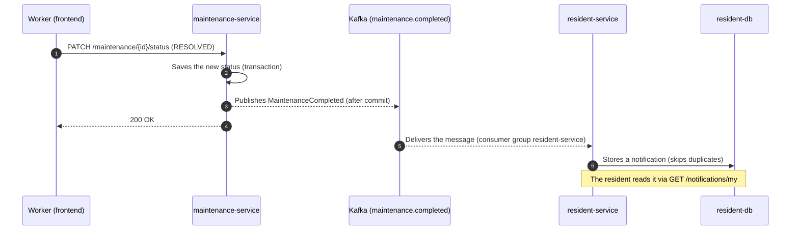

## Event flow: MaintenanceCompleted

When a worker completes a maintenance request, the resident is notified asynchronously
through Kafka. maintenance-service does not know about resident-service, and
resident-service does not know how the request was completed.



A dashed arrow is an asynchronous message, and a solid arrow is a direct call.

| Property | Value |
|---|---|
| Broker | Kafka, single node (`docker-compose.yml`) |
| Topic | `maintenance.completed` |
| Producer | maintenance-service (`MaintenanceEventPublisher`) |
| Consumer | resident-service (`MaintenanceCompletedListener`), consumer group `resident-service` |
| Key | `requestId` |
| Format | JSON as text |
| Fields | `requestId`, `residentId`, `workerId`, `completedAt` (ISO timestamp, UTC) |
| Trigger | The assigned worker sets the status to `RESOLVED` |
| Effect | resident-service stores a row in the `notification` table, which the resident sees in the frontend |

Example message:

```json
{"requestId":3,"residentId":2,"workerId":1,"completedAt":"2026-11-02T15:33:34.063323254Z"}
```