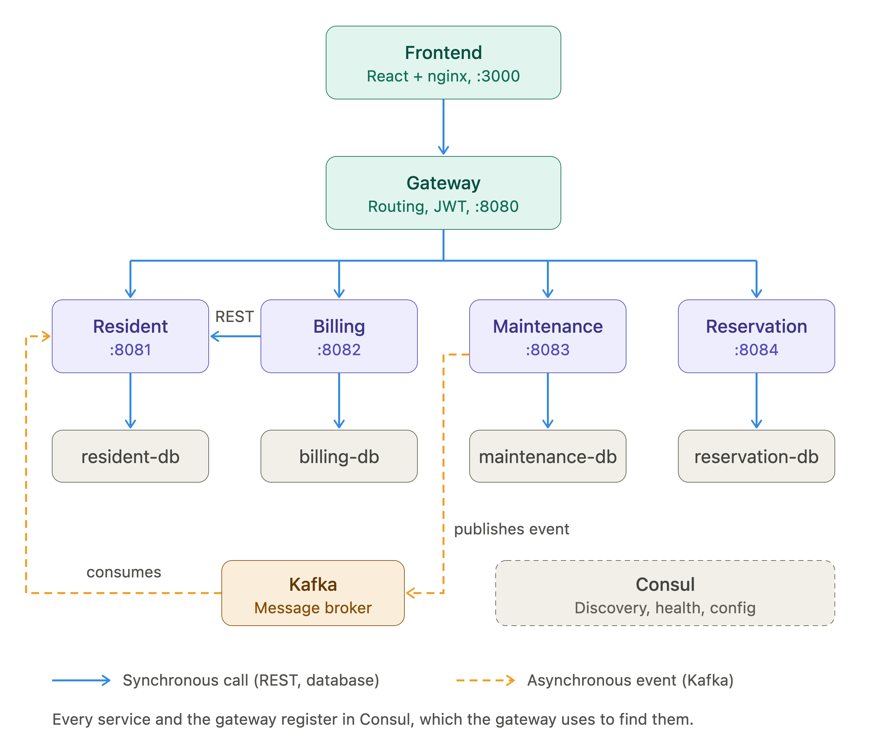
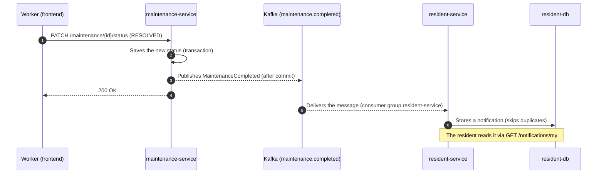

# Architecture

The system is split into four business services behind a single gateway. Each service owns
its data and is deployed as its own container. This document describes the services, how
they communicate, and how a request moves through the system.



Solid blue arrows are synchronous calls (REST and database access). Dashed yellow arrows are
asynchronous events sent through Kafka.

## Contents

- [Components](#components)
- [Communication](#communication)
- [Request flow and security](#request-flow-and-security)
- [Data ownership](#data-ownership)
- [Service discovery and configuration](#service-discovery-and-configuration)
- [Event flow: MaintenanceCompleted](#event-flow-maintenancecompleted)
- [Known limitations](#known-limitations)

## Components

| Component | Port | Responsibility | Database |
|---|---|---|---|
| frontend | 3000 | React app served by nginx, proxies `/api` to the gateway | |
| gateway | 8080 | Single entry point: routing, CORS, JWT check, login rate limit, load balancing | |
| resident-service | 8081 | Apartments, residents, login, notifications | `resident-db` (5432) |
| billing-service | 8082 | Monthly invoices, payments, invoice PDF | `billing-db` (5433) |
| maintenance-service | 8083 | Maintenance requests, workers, work orders | `maintenance-db` (5434) |
| reservation-service | 8084 | Shared resources and bookings | `reservation-db` (5435) |
| security-common | | Shared library for JWT handling, not a deployable service | |
| consul | 8500 | Service discovery, health overview, central configuration | |
| kafka | 9092 | Message broker (KRaft, single node) | |

Only the frontend is published for the application. The gateway and the services are
reachable inside the Docker network only, so no request can skip the JWT check.

## Communication

| Kind | From | To | Why |
|---|---|---|---|
| Synchronous (REST) | browser | frontend, then gateway | Every user action goes through the gateway |
| Synchronous (REST) | gateway | the four services | Routing by path, using `lb://<service-name>` |
| Synchronous (REST) | billing-service | resident-service | Billing needs the apartments and the signed-in resident to generate and show invoices |
| Synchronous (JDBC) | each service | its own database | Each service reads and writes only its own data |
| Asynchronous (Kafka) | maintenance-service | resident-service | A completed request notifies the resident without the two services depending on each other |

The synchronous call from billing to resident uses a service token. The asynchronous flow is
described in detail [below](#event-flow-maintenancecompleted).

## Request flow and security

Gateway routes (the `/api` prefix is stripped before the request reaches the service):

| Path | Service |
|---|---|
| `/api/auth`, `/api/residents`, `/api/apartments`, `/api/notifications` | resident-service |
| `/api/invoices` | billing-service |
| `/api/maintenance`, `/api/workers` | maintenance-service |
| `/api/reservations`, `/api/resources` | reservation-service |

Authentication uses JWT tokens signed with a secret shared by all services:

- Residents and board members sign in at resident-service. Maintenance workers sign in at
  maintenance-service. Both kinds of token are validated by the same library
  (`security-common`).
- The gateway validates the token on every request, and each service validates it again and
  enforces its own roles (`RESIDENT`, `BOARD`, `WORKER`).
- Worker tokens have a non-numeric subject (`worker:<id>`), so a worker token can never be
  mistaken for a resident id.
- Logins are limited per client address (default 5 per minute). The counter lives in memory,
  so it is per gateway instance.

## Data ownership

Each service has its own Postgres database, with the schema managed by Flyway migrations
inside the service. No service reads another service's database. When a service needs data
owned by another, it asks through the API (billing to resident) or reacts to an event
(resident reacting to a completed maintenance request). Resident-service keeps its own copy
of what it needs from an event, in the `notification` table.

## Service discovery and configuration

Every service and the gateway register in Consul. The gateway has no hard-coded service
addresses and looks up healthy instances instead, which also lets it spread requests over
several instances of the same service. Shared, non-secret settings (the JWT lifetime, the
Kafka topic name and the login rate limit) are loaded from Consul's key/value store.
Secrets and per-environment addresses stay in environment variables. See the
[README](../README.md) for how to open the Consul UI and run several instances.

## Event flow: MaintenanceCompleted

When a worker completes a maintenance request, the resident is notified asynchronously
through Kafka. maintenance-service does not know about resident-service, and
resident-service does not know how the request was completed.



A dashed arrow is an asynchronous message, and a solid arrow is a direct call.

| Property | Value |
|---|---|
| Broker | Kafka, single node (`docker-compose.yml`) |
| Topic | `maintenance.completed` |
| Producer | maintenance-service (`MaintenanceEventPublisher`) |
| Consumer | resident-service (`MaintenanceCompletedListener`), consumer group `resident-service` |
| Key | `requestId` |
| Format | JSON as text |
| Fields | `requestId`, `residentId`, `workerId`, `completedAt` (ISO timestamp, UTC) |
| Trigger | The assigned worker sets the status to `RESOLVED` |
| Effect | resident-service stores a row in the `notification` table, which the resident sees in the frontend |

Example message:

```json
{"requestId":3,"residentId":2,"workerId":1,"completedAt":"2026-11-02T15:33:34.063323254Z"}
```

Design choices:

- **After commit:** the event is published only after the database change is committed
  (`@TransactionalEventListener`, `AFTER_COMMIT`), so a resident is never told about a status
  change that was rolled back.
- **A table for notifications:** Kafka is a stream that can be emptied, and the frontend
  cannot read from it. A notification also needs state per resident (read or unread).
- **Duplicates:** Kafka delivers at least once. The `notification` table has a unique key on
  `(resident_id, request_id)` and the service checks before saving, so a repeated message
  gives one notification.
- **Unknown resident:** the message is logged and skipped instead of stopping the consumer.

## Known limitations

- **The event can be lost.** If Kafka is down at the moment maintenance-service publishes, the
  status is saved but the resident is never notified. There is no outbox or retry. In
  production the event would be written to an `outbox` table in the same transaction as the
  status change and sent from there.
- **No dead-letter topic.** Messages that cannot be processed are dropped after Spring
  Kafka's default retries.
- **Single Kafka node without a volume.** The topic is emptied when the container is
  recreated. This is fine for development, not for production.
- **Notifications are fetched by polling.** The frontend asks every 30 seconds. Server-sent
  events or WebSockets would show them at once.
- **The login rate limit is per gateway instance**, so run one gateway.